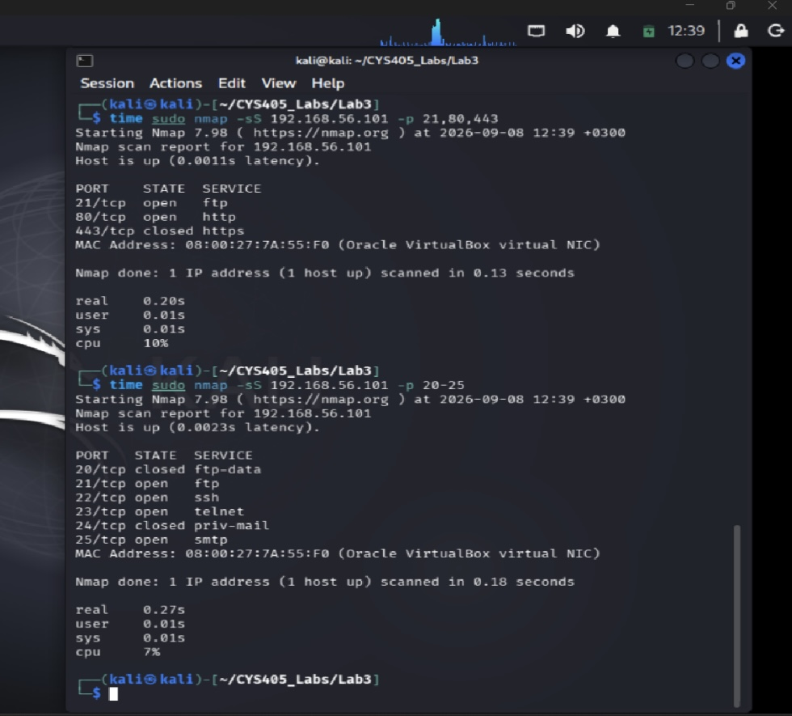

# Network Scanning & Discovery

## Overview
This lab focuses on network discovery, port scanning,
and service identification using Nmap and Zenmap in
an authorized virtual laboratory environment.

## Tools & Technologies
- Kali Linux
- Nmap
- Zenmap
- Virtual Machines

## Objectives
- Discover active hosts within a network.
- Identify open TCP and UDP ports.
- Detect running network services.
- Understand how network scanning supports
  security assessments.

## Methodology
1. Configured an isolated virtual lab environment.
2. Performed host discovery using Nmap.
3. Conducted TCP and UDP port scanning.
4. Examined open ports and running services.
5. Used Zenmap to visualize and analyze scan results.
6. Documented findings for security analysis.

## Skills Demonstrated
- Network Reconnaissance
- Host Discovery
- Port Scanning
- Service Identification
- Network Security Assessment
- Technical Documentation

## Security & Ethics
All scanning activities were performed in authorized
educational environments for learning purposes.

## Lab Evidence

### Nmap TCP SYN Scanning

Performed TCP SYN scans against an authorized virtual machine to identify open and closed ports.

The scans identified open services including FTP, SSH, Telnet, and HTTP.

