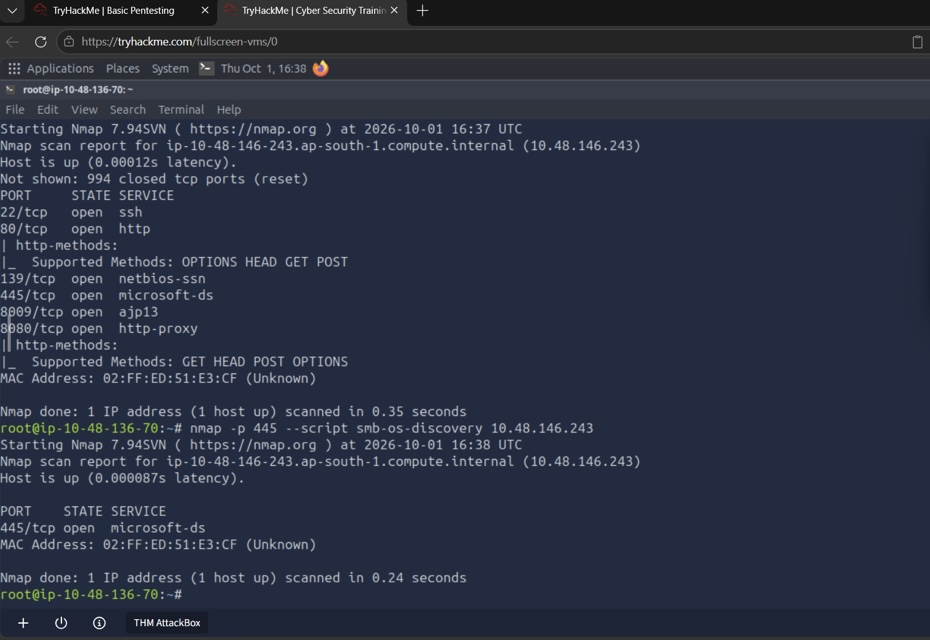
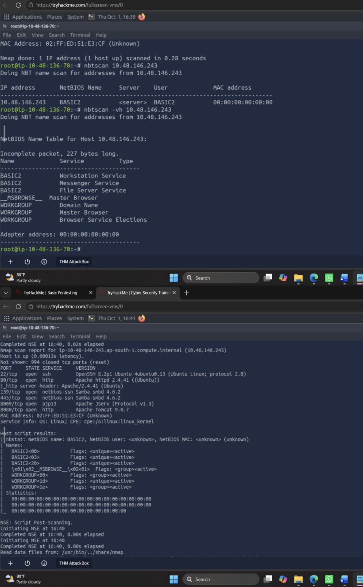

# Network Enumeration Using Nmap

## Overview
This lab demonstrates practical network enumeration techniques using Nmap and other cybersecurity tools in an authorized virtual laboratory environment.

The objective is to identify network services, gather system information, and analyze potential security weaknesses.

## Tools & Technologies
- Kali Linux
- Nmap
- Nmap Scripting Engine (NSE)
- NBTScan
- Virtual Machines

## Objectives
- Perform HTTP enumeration.
- Identify web directories and supported HTTP methods.
- Enumerate SMB and NetBIOS services.
- Identify operating system and service information.
- Investigate FTP services and configurations.
- Document security findings.

## Methodology

### 1. HTTP Enumeration
Used Nmap scripts to identify web directories, applications, and supported HTTP methods.

Scripts:
- http-enum
- http-methods

### 2. SMB Enumeration
Performed SMB enumeration to investigate file-sharing services and gather system information.

Scripts:
- smb-os-discovery
- smb-enum-shares

### 3. NetBIOS Enumeration
Used NBTScan and Nmap to identify NetBIOS names, workgroups, and network services.

Tools:
- nbtscan
- nbstat.nse

### 4. FTP Enumeration
Used Nmap scripts to check FTP service availability and potential security misconfigurations.

Scripts:
- ftp-syst
- ftp-anon
- ftp-vsftpd-backdoor

## Key Findings
- Identified exposed web directories and application endpoints.
- Examined supported HTTP methods.
- Identified Samba service information.
- Discovered NetBIOS host and workgroup information.
- Observed that SMB enumeration scripts did not disclose shares.
- Found no active FTP service on the assessed target.

## Skills Demonstrated
- Network Enumeration
- Service Discovery
- HTTP Security Assessment
- SMB and NetBIOS Analysis
- Nmap Scripting Engine
- Security Findings Documentation

## Security & Ethics
All enumeration activities were performed in an authorized educational laboratory environment for cybersecurity learning purposes.

## Lab Evidence

### HTTP and SMB Enumeration

Performed network enumeration using Nmap to identify open ports, HTTP methods, and SMB services in an authorized virtual lab environment.

The scan identified:
- Open ports: 22, 80, 139, 445, 8009, and 8080.
- HTTP methods: GET, HEAD, POST, and OPTIONS.
- SMB service running on port 445.

### NetBIOS Enumeration

Performed NetBIOS enumeration using NBTScan and Nmap to identify host information and network services.

The scan identified:
- NetBIOS hostname: BASIC2
- Workgroup: WORKGROUP
- SMB service on port 445

